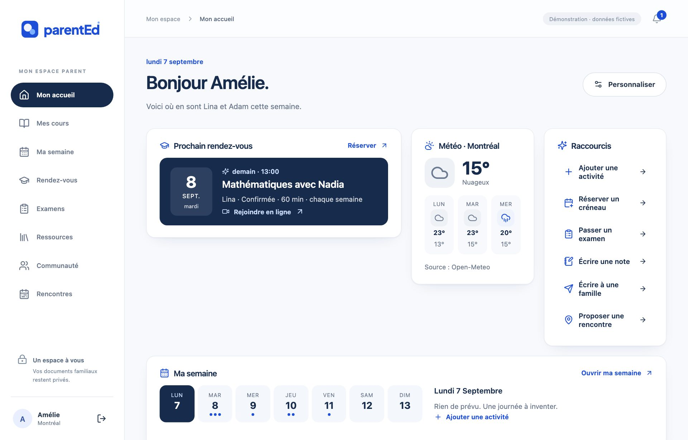
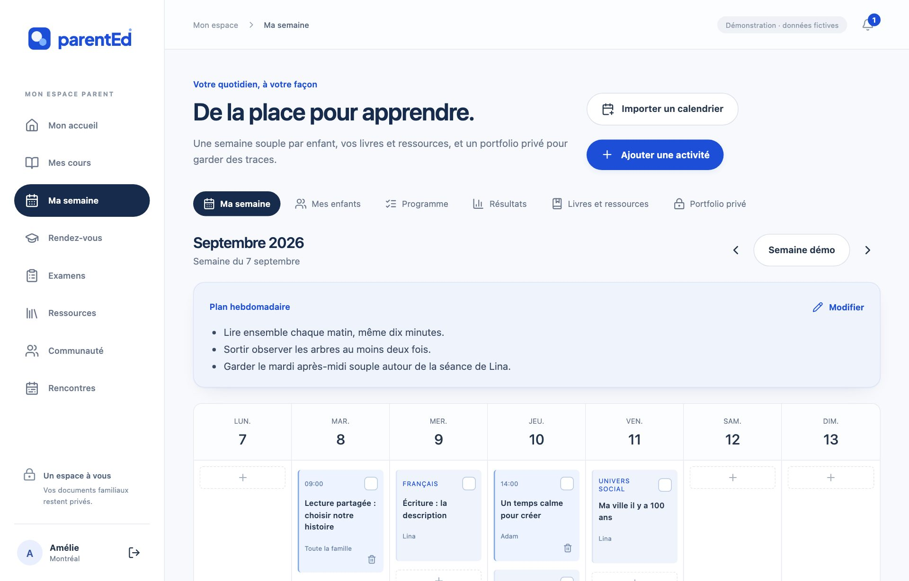
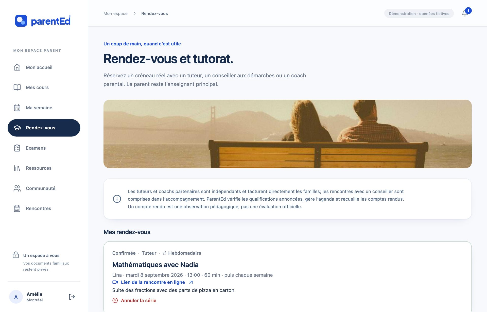

<p align="center">
  
</p>

# ParentEd — Muslim Hacks Montréal

**My hackathon project for Muslim Hacks in Montréal.**

I built ParentEd to explore a practical question: how could homeschooling parents find learning resources, organize family life and connect with other families in one place?

The result is a French-language prototype with an English/French landing page, courses for parents, family planning, community features and simulated tutoring. This repository preserves the hackathon experience as a **self-contained local demo**. It is not a live commercial service.



## Try it locally

Node.js 22.13+ and npm are required.

```sh
npm ci
npm run dev
```

Open [localhost:5173](http://127.0.0.1:5173), choose **Voir la démonstration**, then **Explorer avec Amélie**.

**No API keys, `.env` setup, cloud account, subscription or payment required.** Package installation downloads dependencies; the running app uses bundled assets and browser storage. Official resource links only open external sites when clicked.

| Fictional profile | Explore |
| --- | --- |
| Amélie — parent | Courses, progress, planning, portfolio, results and bookings |
| Sami — another family | A separate family’s demo view |
| Nadia — tutor | Simulated appointments and reports |
| Camille — admin | Content management and moderation |

Changes persist in the same browser. These profiles are not secure authentication, and localStorage is not suitable for confidential data. Use fictional information only. Clear this site’s browser data to reset the demo.

## What I built

- **Learning:** courses for parents, lessons, exercises, personal notes and saved progress.
- **Family organization:** weekly activities, child profiles, curriculum planning, portfolio, results and calendar import/export.
- **Community:** discussions, groups, directory and simulated messages.
- **Meetups:** lists, calendar and a schematic map with fictional markers.
- **Tutoring:** fictional providers, availability, bookings and reports; no real appointment is made.
- **Practice exams:** sample questions, timed attempts and results.
- **Administration:** editing content and moderating demo discussions.
- **Local help:** searching bundled content; no AI API call.

The weather widget uses a clearly labelled fictional fixture. Maps retain their interactive markers on a local grid, without requesting external map tiles. These changes keep the archived demo independent of services or credentials.

## Screenshots

These capture the original hackathon prototype; the archived version replaces live maps and weather with local examples.

| Family planning | Courses and tutoring |
| --- | --- |
|  |  |

## Technical approach

React 19, TypeScript, Vite, Leaflet and Lucide. Business rules and a data gateway are separated from the UI. The active gateway is the browser-only simulator.

The original implementation explored Supabase authentication, PostgreSQL row-level security and private file storage, with Cloudflare hosting. The public archive removes the live connector, account provisioning, deploy commands, cloud configuration and paid AI/email functions. The SQL migrations remain as design evidence and are exercised locally using PostgreSQL/PGlite; they do not connect to a server.

| Directory | Purpose |
| --- | --- |
| `src/components/` | Product screens and interactions |
| `src/domain.ts` | Business rules and data types |
| `src/data/demo.ts` | Browser-only demo persistence |
| `src/data/seed.ts` | Fictional profiles and content |
| `supabase/migrations/` | Historical database design, tested locally |
| `tests/` | Business and PostgreSQL permission tests |
| `docs/` | Demo walkthrough, architecture, verification and credits |
| `video/` | Original presentation source and assets; generated MP4s are excluded |

## Development checks

```sh
npm test
npm run build
npm run check:safety
npm run preview
```

The safety check looks for credential patterns, forbidden cloud dependencies/configuration, runtime environment variables and network APIs. It fails rather than printing matched credential values. It is a regression check, not a guarantee that every possible secret format can be detected.

SQL tests verify the original database rules in PGlite with minimal Auth/Storage schemas. They do not prove a deployed backend is secure. The local simulator’s family separation demonstrates behavior, not protection against someone who can access this browser.

## Scope

This is a hackathon prototype, not a school, an educational compliance guarantee or an active service. The content, families, tutors and events are fictional. There are no purchases, real emails, real account registration or paid integrations in this edition.

Removing code does **not** cancel any previously created hosting plan or API account. The current repository contains no automatic path to deploy or call those services. See [SECURITY.md](SECURITY.md) for historical credentials and [the service retirement checklist](docs/service-retirement.md) for previously deployed infrastructure.

## Project notes

- [Demo walkthrough](docs/demo-jury.md)
- [Architecture](docs/architecture.md)
- [Cleanup and verification status](docs/progress.md)
- [Photo credits](docs/credits-photos.md)
- [Presentation source](video/README.md)

Brand identity: supplied parentEd logo and blue palette. Icons: Lucide. Photos: credits linked above. The interface is in French to reflect the Québec families the concept was designed for.
